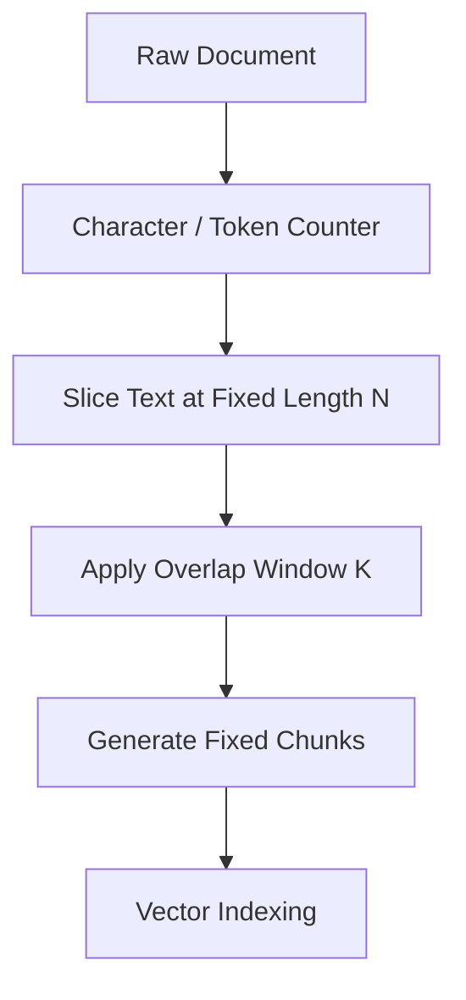
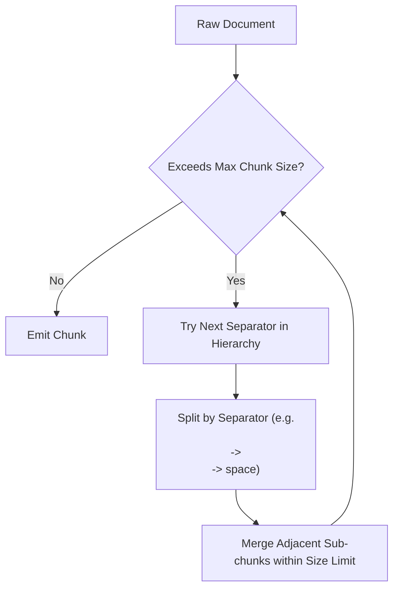
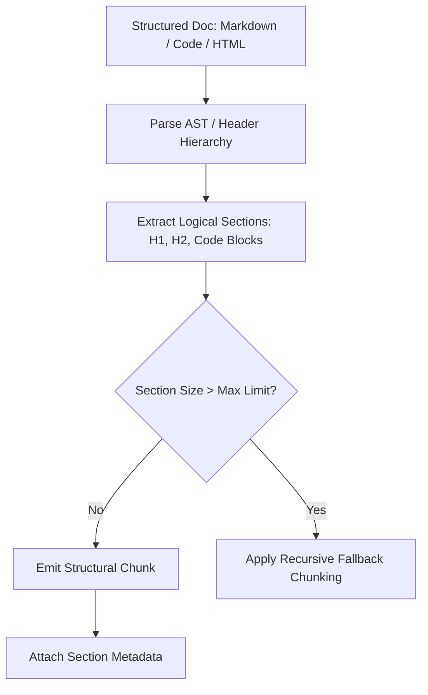
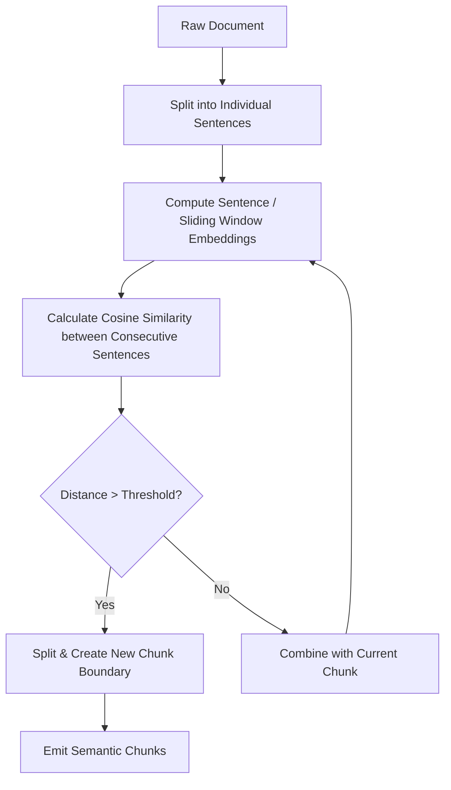
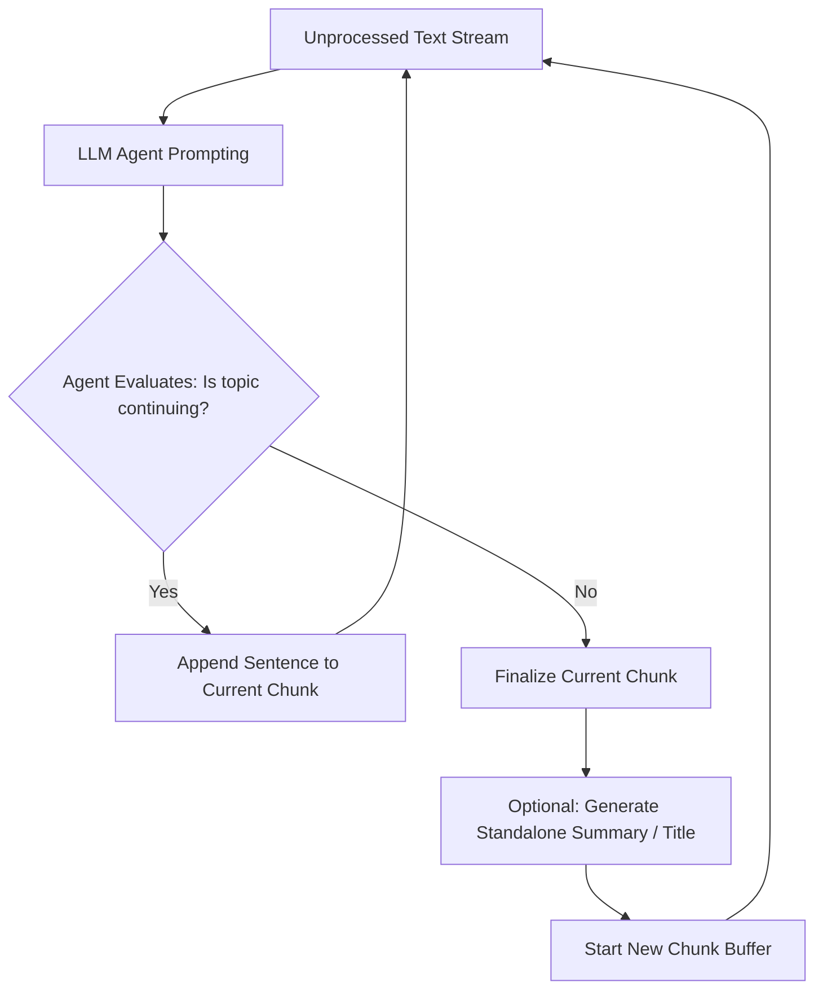
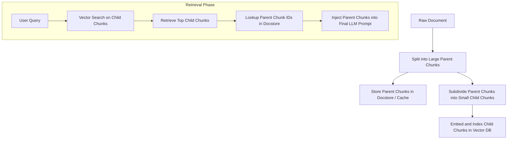

# Types of Chunking Strategies for RAG

Chunking is the process of breaking down large unstructured text into smaller, meaningful segments before embedding and storing them in a vector database. Selecting the optimal chunking strategy is crucial: chunks that are too large dilute semantic specificity, while chunks that are too small lose necessary contextual coherence.

---

## Overview Comparison Matrix

| **Chunking Strategy** | **Semantic Coherence** | **Processing Latency/Cost** | **Implementation Complexity** | **Best Use Case** |
| :--- | :--- | :--- | :--- | :--- |
| **Fixed-Size Chunking** | Low | Low | Very Low | Baseline testing, simple standardized text |
| **Recursive Character** | Medium | Low | Low | General domain documents, articles, books |
| **Document-Specific** | High | Low - Medium | Medium | Markdown, HTML, JSON, source code |
| **Semantic Chunking** | High | Medium | Medium - High | Prose, research papers, conversational transcripts |
| **Agentic Chunking** | Very High | High (LLM Cost) | High | Enterprise knowledge bases, ambiguous documents |
| **Parent-Document (Small-to-Big)**| Very High | Low - Medium | Medium | Complex documents requiring precise search + deep context |

---

## 1. Fixed-Size Chunking

Fixed-Size Chunking splits text into chunks based on a predefined token or character count, often with an intentional overlapping region between consecutive chunks to preserve contextual continuity.

### Workflow Diagram (Mermaid)



### Visual Illustration

```
Source Text: [ "The quick brown fox jumps over the lazy dog near the riverbank." ]

Fixed Chunk Size = 25 chars, Overlap = 10 chars

Chunk 1: [ The quick brown fox jumps ]
                      │◄── Overlap (10 chars) ──►│
Chunk 2:           [ fox jumps over the lazy dog ]
                                    │◄── Overlap (10 chars) ──►│
Chunk 3:                         [ lazy dog near the riverbank. ]
```

### Core Mechanics

1. Define a hard token limit (e.g., $256$ tokens) and an overlap percentage (e.g., $10\% - 20\%$).
2. The tokenizer moves sequentially through the document stream, slicing chunks at fixed increments without analyzing semantic boundaries or sentence endings.

### Trade-offs & Analysis

* **Benefits:**
  * Highly computational efficient with $O(N)$ execution speed.
  * Simple to implement without relying on heavy external dependencies or LLMs.
  * Ensures uniform context window usage across vector database indices.
* **Drawbacks:**
  * Frequently splits words, sentences, or paragraphs mid-thought, severing semantic context.
  * Introduces noise into vector embeddings due to incomplete concepts.

---

## 2. Recursive Character Chunking

Recursive Character Chunking splits text iteratively using a prioritized hierarchy of separators (e.g., `["\n\n", "\n", " ", ""]`). It attempts to keep paragraphs and sentences intact before resorting to smaller separators.

### Workflow Diagram (Mermaid)



### Visual Illustration

```
Paragraph 1 \n\n Paragraph 2 \n\n Paragraph 3 \n\n Paragraph 4
│                                                        │
├──────────────── Target Chunk Size Exceeded ─────────────┤
│                                                        │
▼ [Split at '\n\n']
├── Chunk A: [ Paragraph 1 \n\n Paragraph 2 ] (Fits size limit)
└── Chunk B: [ Paragraph 3 \n\n Paragraph 4 ] (Fits size limit)
```

### Core Mechanics

1. Evaluate text against target chunk size.
2. If size limit is exceeded, split on `\n\n` (paragraph level).
3. If individual paragraphs still exceed the limit, split on `\n` (sentence level).
4. If individual sentences exceed the limit, split on spaces `" "` (word level).
5. Combine contiguous smaller pieces into chunks up to the configured size limit.

### Trade-offs & Analysis

* **Benefits:**
  * Preserves natural linguistic structure (paragraphs and sentences stay unified).
  * Highly recommended as the default starting strategy for general domain texts.
  * Fast execution time without requiring external API calls.
* **Drawbacks:**
  * Structured content with atypical separators (e.g., source code, logs) requires custom separator lists.
  * Fixed token limits can still truncate long sentences unexpectedly.

---

## 3. Document-Specific / Structure-Aware Chunking

Structure-Aware Chunking leverages native document syntax (e.g., Markdown headers, HTML tags, Python function definitions, JSON keys) to divide content according to logical structural sections.

### Workflow Diagram (Mermaid)



### Visual Illustration

```
# Header 1 (Document Title)
  │
  ├── ## Section A (Introduction)
  │     └── [ Chunk 1: Markdown Section A Content ]
  │
  └── ## Section B (Technical Details)
        ├── ### Subsection B1
        │     └── [ Chunk 2: Markdown Subsection B1 Content ]
        └── ### Subsection B2
              └── [ Chunk 3: Markdown Subsection B2 Content ]
```

### Core Mechanics

1. A parser generates an Abstract Syntax Tree (AST) or inspects structural cues (e.g., `#`, `##`, `<h3>`, `def`).
2. Text under common parent headings is grouped into a single distinct chunk.
3. Heading hierarchies are appended as metadata key-value pairs to the generated chunk (e.g., `{"Header_1": "Architecture", "Header_2": "Database"}`).

### Trade-offs & Analysis

* **Benefits:**
  * Maintains explicit context and boundary continuity according to human-designed document structure.
  * Preserves metadata relationships, enhancing filtering capabilities during retrieval.
* **Drawbacks:**
  * Less effective on poorly formatted or unstructured plain-text documents.
  * Section sizes can vary drastically (e.g., a short 2-line section vs. a 10-page section requiring secondary fallback chunking).

---

## 4. Semantic Chunking

Semantic Chunking monitors the semantic drift between consecutive sentences using embedding models. When the cosine distance between consecutive sentence embeddings exceeds a configured threshold, a chunk boundary is created.

### Workflow Diagram (Mermaid)



### Visual Illustration

```
Sentence Index:    S1      S2      S3     │     S4      S5      S6
Cosine Distance:    [0.12]  [0.15]  [0.18] │ [0.72]  [0.11]  [0.14]
                                          │
Semantic Break: ──────────────────────────┴──────────────────────────
                             (Threshold Spike = 0.50)

Chunk 1: [ S1 + S2 + S3 ] (Topic: Vector Search)
Chunk 2: [ S4 + S5 + S6 ] (Topic: Database Replication)
```

### Core Mechanics

1. Segment text into single sentences.
2. Group sentences into small sliding windows and calculate dense vector embeddings for each.
3. Compute statistical differences (e.g., $1 - \text{CosineSimilarity}$) between consecutive windows.
4. Set a boundary wherever distance spikes above a calculated threshold (e.g., $95^{\text{th}}$ percentile or fixed standard deviation).

### Trade-offs & Analysis

* **Benefits:**
  * Ensures that chunks contain semantically coherent thoughts rather than arbitrary text lengths.
  * Eliminates cross-topic blending within individual vector database entries.
* **Drawbacks:**
  * Computationally expensive; requires running an embedding model over every sentence during preprocessing.
  * Sensitive to distance threshold tuning—improper settings cause over-segmentation or under-segmentation.

---

## 5. Agentic Chunking

Agentic Chunking utilizes an LLM as a decision maker to read a document sequentially, decide where logical topic transitions occur, and optionally generate standalone summaries for each chunk.

### Workflow Diagram (Mermaid)



### Visual Illustration

```
[ Sentence Stream Ingestion ]
           │
           ▼
┌──────────────────────────────────────────────────────────┐
│                      LLM AGENT                           │
│ "Does Sentence 4 introduce a new topic compared to S1-S3?"│
└────────────────────────────┬─────────────────────────────┘
                             │
            ┌────────────────┴────────────────┐
            ▼                                 ▼
      [ YES: Split ]                    [ NO: Append ]
            │                                 │
  Chunk 1 Finalized                 Continue Current Buffer
  + Auto-Generated Title
```

### Core Mechanics

1. An LLM agent processes text sequentially or in overlapping windows.
2. Prompts direct the model to evaluate context continuity, determine topic shifts, and emit explicit split markers.
3. The LLM can simultaneously rewrite or enrich the chunk with contextual headers to make it self-contained.

### Trade-offs & Analysis

* **Benefits:**
  * High-quality context division capable of handling complex, unstructured, multi-topic inputs.
  * Can automatically resolve ambiguous references and pronouns prior to vector storage.
* **Drawbacks:**
  * Extremely high financial cost and high latency due to multiple LLM inference passes per document.
  * Subject to non-deterministic output and rate limits during large batch ingestion tasks.

---

## 6. Parent-Document / Small-to-Big Chunking

Parent-Document Chunking decouples the text used for **retrieval** from the text passed to the **LLM for generation**. Documents are split into small leaf chunks (for accurate vector matching) mapped back to larger parent chunks or full documents (for generation context).

### Workflow Diagram (Mermaid)



### Visual Illustration

```
Parent Chunk (Large Context: 1024 Tokens) - Stored in Document Store
┌──────────────────────────────────────────────────────────────────────────────┐
│ ...The enterprise migration required three phases. Phase 1 focused on data   │
│ center consolidation. Phase 2 migrated workloads to Kubernetes...           │
└──────┬──────────────────────────────┬──────────────────────────────┬─────────┘
       │                              │                              │
       ▼                              ▼                              ▼
Child Chunk 1 (128 Tks)      Child Chunk 2 (128 Tks)       Child Chunk 3 (128 Tks)
[Phase 1 Data Center...]     [Phase 2 Kubernetes...]       [Phase 3 Cloud Native...]
       │                              │                              │
       └──────────────────────────────┴──────────────────────────────┘
                                      │
                        Indexed in Vector Store for Retrieval
```

### Core Mechanics

1. Segment text into large, context-rich **Parent Chunks** (e.g., $1024 - 2048$ tokens) and store them in an in-memory or key-value document store keyed by a unique ID.
2. Subdivide each parent chunk into multiple smaller **Child Chunks** (e.g., $128 - 256$ tokens).
3. Embed and store only the child chunks along with a reference pointer (`parent_id`) in the vector database.
4. During retrieval, match against the child chunks, but fetch and pass their corresponding parent chunks to the LLM.

### Trade-offs & Analysis

* **Benefits:**
  * Solves the trade-off between precise search retrieval and context-rich LLM generation.
  * Small child chunks yield high similarity scores, while large parent chunks prevent loss of background context.
* **Drawbacks:**
  * Increases storage overhead by maintaining dual storage systems (Vector DB + Key-Value Store).
  * Adds lookup overhead during the query retrieval lifecycle.

---

## Strategic Selection Guide

```
                         What is your document type?
                                      │
         ┌────────────────────────────┼────────────────────────────┐
         ▼                            ▼                            ▼
   [ Structured ]             [ Code / Markup ]            [ Narrative / Prose ]
         │                            │                            │
  Structure-Aware              Document-Specific           What is your budget/latency?
     Chunking                      Chunking                        │
                                                   ┌───────────────┴───────────────┐
                                                   ▼                               ▼
                                            [ High Speed ]                  [ High Quality ]
                                                   │                               │
                                        Recursive Character            ┌───────────┴───────────┐
                                              Chunking                 ▼                       ▼
                                                                Semantic Chunking      Parent-Document
                                                                                           Chunking
```


